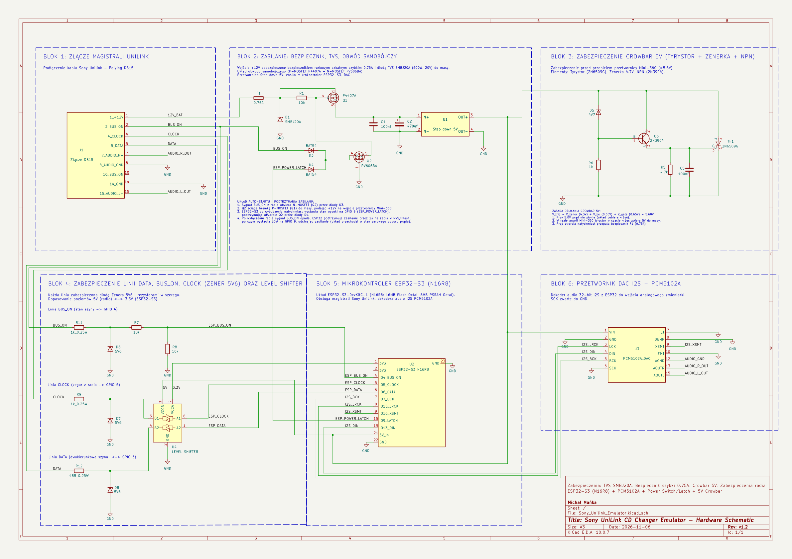
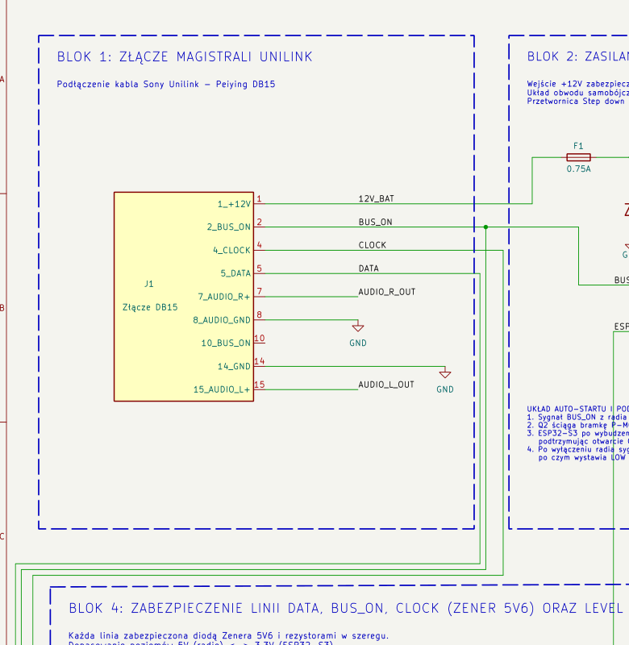
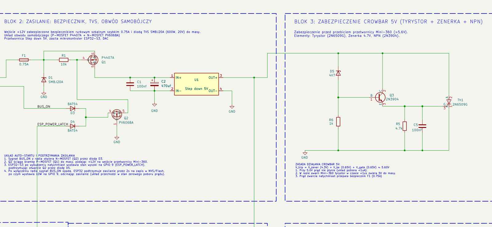
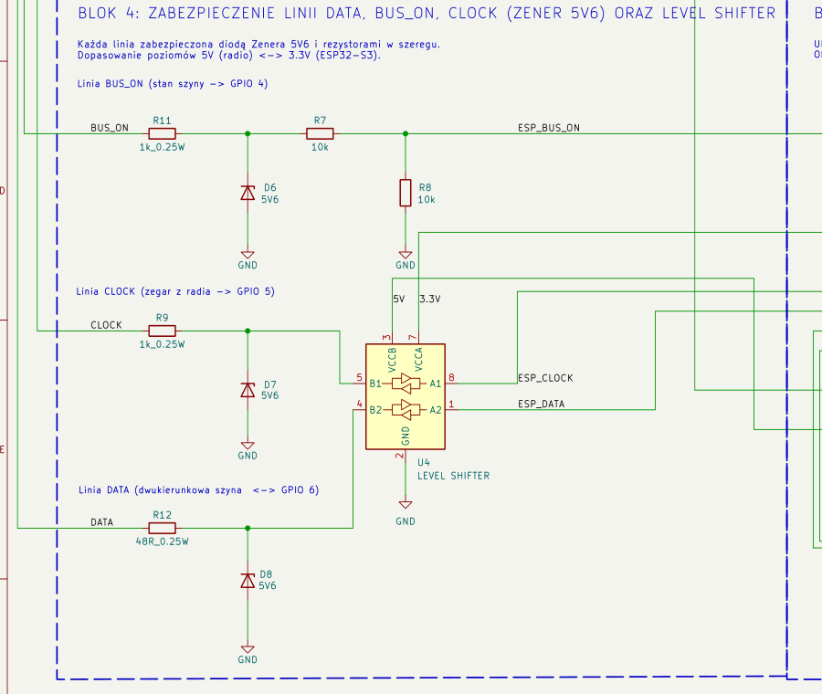
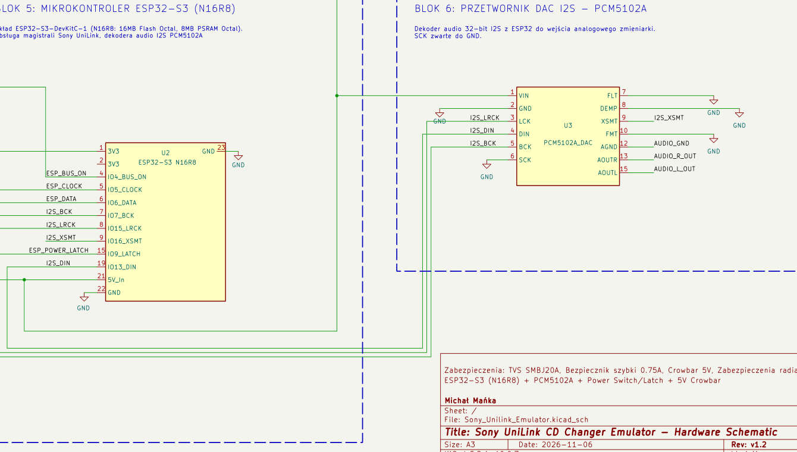

# Emulator Zmieniarki Sony UniLink (ESP32-S3 + I2S DAC)

**Wersja emulatora:** 1.0  
**Kompatybilność:** Testowane i w 100% funkcjonalne na radioodtwarzaczu **Sony CDX-M670** (inne modele radioodtwarzaczy Sony UniLink nie były testowane).

---

## Spis treści
1. [Opis projektu](#opis-projektu)
2. [Schemat ideowy (Hardware)](#schemat-ideowy-hardware)
   - [Złącze magistrali UniLink DB15 (J1)](#złącze-magistrali-unilink-db15-j1)
   - [Układ zasilania, klucz MOSFET i podtrzymanie zasilania](#układ-zasilania-klucz-mosfet-i-podtrzymanie-zasilania)
   - [Konwerter poziomów i dopasowanie magistrali UniLink](#konwerter-poziomów-i-dopasowanie-magistrali-unilink)
   - [Mikrokontroler ESP32-S3 i przetwornik DAC PCM5102A](#mikrokontroler-esp32-s3-i-przetwornik-dac-pcm5102a)
   - [Tabela połączeń pinów ESP32-S3](#tabela-połączeń-pinów-esp32-s3)
3. [Zasada działania oprogramowania (Software Architecture)](#zasada-działania-oprogramowania-software-architecture)
   - [Wielozadaniowość FreeRTOS](#wielozadaniowość-freertos)
   - [Protokół magistrali Sony UniLink](#protokół-magistrali-sony-unilink)
   - [Mechanizm wirtualnej zmieniarki CD](#mechanizm-wirtualnej-zmieniarki-cd)
   - [Obsługa CD-Text](#obsługa-cd-text)
   - [Automatyczne zasilanie i procedura wyłączenia](#automatyczne-zasilanie-i-procedura-wyłączenia)
4. [Struktura nośnika USB (Pendrive)](#struktura-nośnika-usb-pendrive)
5. [Diagnostyka i czarna skrzynka (CrashLog)](#diagnostyka-i-czarna-skrzynka-crashlog)

---

## Opis projektu

Projekt realizuje sprzętowy i programowy emulator zmieniarki płyt CD podłączany do fabrycznej magistrali **Sony UniLink** w radioodtwarzaczach samochodowych Sony (zweryfikowany na modelu CDX-M670). 

Emulator oparty jest o mikrokontroler **ESP32-S3 (N16R8)** i przetwornik cyfrowo-analogowy **PCM5102A** połączony magistralą **I2S**. Źródłem dźwięku jest standardowy pendrive USB (FAT32) wpinany w port USB Host ESP32-S3, na którym muzyka pogrupowana jest w folderach odpowiadających kolejnym płytom CD (`CD01`..`CD10`).

Główne cechy emulatora:
- **Pełna emulacja protokołu UniLink:** radio wykrywa urządzenie jako fizyczną zmieniarkę 10-płytową CD (zmieniarka melduje się w grupie adresowej `0x30`, otrzymuje adres np. `0x31` i odpowiada na zapytania ping `01 12`, komendy sterujące oraz żądania danych).
- **Emulacja CD-Text:** nazwy folderów oraz plików audio przekazywane są do radia i wyświetlane na ekranie (wariant klasyczny oraz ramki `0xD2` dla wyświetlacza CDX-M670).
- **Płynne sterowanie odtwarzaniem:** zmiana płyt (Disc +/-), utworów (Track +/-), bezpośredni wybór płyty (`0xB0`), przewijanie w utworze z narastającym przyspieszeniem (FF/REW) i słyszalnym podsłuchem cue, obsługa trybów Repeat (Off / One / All) oraz Shuffle.
- **Automatyczny Power Management:** układ uruchamia się automatycznie po wykryciu napięcia na linii `BUS ON` radia, a po wyłączeniu radia podtrzymuje zasilanie przez 2 sekundy na bezpieczny zapis stanu do pamięci NVS / dysku USB, po czym całkowicie odcina zasilanie przetwornicy (zerowy pobór prądu z akumulatora w stanie spoczynku).

---

## Schemat ideowy (Hardware)

Pełny schemat ideowy urządzenia został zaprojektowany w programie KiCad:



Pliki źródłowe KiCad znajdują się w katalogu [`hardware/`](file:///d:/Komis.Net/Emulacja-Sony-Unilink/hardware/):
- `Sony_Unilink_Emulator.kicad_sch` — schemat ideowy
- `Sony_Unilink_Emulator.pdf` — wersja wektorowa do druku
- `Sony_Unilink_Emulator.svg` — schemat w formacie wektorowym SVG

---

### Złącze magistrali UniLink DB15 (J1)

Do połączenia z instalacją samochodową i radiem służy dedykowany przewód UniLink zakończony złączem DB15 (J1):



Układ wyprowadzeń złącza DB15:
- **Pin 1 (`12V_BAT`):** Stałe zasilanie +12V z akumulatora pojazdu / wiązki radia (zabezpieczone bezpiecznikiem topikowym F1).
- **Pin 2 (`BUS_ON`):** Sygnał sterujący załączeniem radia (+12V = radio włączone, 0V = radio wyłączone).
- **Pin 4 (`CLOCK`):** Zegar magistrali UniLink generowany przez radio (poziom logiczny 0–5V).
- **Pin 5 (`DATA`):** Dwukierunkowa linia danych magistrali UniLink (aktywna stanem niskim, podciągana w radiu do 5V).
- **Pin 7 (`AUDIO_R_OUT`):** Prawy kanał wyjściowy audio z przetwornika DAC PCM5102A.
- **Pin 8 (`AUDIO_GND`):** Masa sygnałowa audio (podłączona do masy przetwornika i radia).
- **Pin 14 (`GND`):** Główna masa zasilania i magistrali cyfrowej.
- **Pin 15 (`AUDIO_L_OUT`):** Lewy kanał wyjściowy audio z przetwornika DAC PCM5102A.

---

### Układ zasilania, klucz MOSFET i podtrzymanie zasilania

Układ zasilania odpowiada za automatyczne załączanie urządzenia, zabezpieczenie przed przepięciami w instalacji samochodowej oraz bezprądowe wyłączenie:



1. **Zabezpieczenie wejścia 12V:**
   - Szybki bezpiecznik topikowy **F1** (0.75A, obudowa SMD 0805).
   - Jednokierunkowa dioda TVS **D1** (SMBJ20A, obudowa DSN1608-2) tłumiąca szpilki przepięciowe powyżej 20V oraz zabezpieczająca przed odwrotnym podłączeniem zasilania.
2. **Klucz główny P-MOSFET (Q1 - P4407A):**
   - Źródło (Source) podłączone do wejściowego +12V za bezpiecznikiem F1.
   - Dren (Drain) zasila wejście przetwornicy impulsowej Mini-360.
   - Bramka (Gate) podciągnięta rezystorem **R1** (10 kΩ) do źródła, co utrzymuje tranzystor zatkany w stanie spoczynku.
3. **Układ załączania i podtrzymania (Q2 - PV606BA / D3 / D4):**
   - Załączenie zasilania następuje przez ściągnięcie bramki Q1 do masy przez tranzystor N-MOSFET **Q2**.
   - **Start (Auto-on):** Pojawienie się stanu wysokiego (+12V) na linii `BUS_ON` z radia otwiera tranzystor Q2 przez diodę Schottky **D3** (BAT54).
   - **Podtrzymanie (Power Latch):** Po uruchomieniu ESP32-S3 natychmiast wystawia stan wysoki (3.3V) na linii `ESP_POWER_LATCH` (GPIO 9), podtrzymując otwarcie Q2 przez diodę **D4** (BAT54).
   - **Wyłączenie (Suicide Off):** Po wyłączeniu radia sygnał `BUS_ON` opada do 0V. Oprogramowanie wykrywa brak aktywności, podtrzymuje zasilanie przez 2 sekundy (zapis NVS i zrzut logów), po czym wystawia stan niski na GPIO 9, co zamyka Q2, zamyka Q1 i całkowicie odcina zasilanie emulatora.
4. **Przetwornica Step-Down (U1 - Mini-360):**
   - Moduł przetwornicy impulsowej buck opartej na układzie MP2307DN, obniżającej napięcie z 12V do stabilnego **5.0V** do zasilania ESP32-S3 (`5V_In`) oraz przetwornika PCM5102A (`VIN`).
   - Kondensatory filtrujące wejście: **C1** (100 nF) oraz **C2** (470 µF).
5. **Zabezpieczenie wyjścia 5V Crowbar (D5 / Q3 / Th1):**
   - Chroni mikrokontroler przed przebiciem przetwornicy Mini-360 (gdyby na szynę 5V przedostało się napięcie z instalacji 12V).
   - Elementy: Tyrystor SCR **Th1** (2N6509G), dioda Zenera **D5** (4.7V), tranzystor NPN **Q3** (2N3904), rezystory **R6** (1 kΩ) i **R5** (4.7 kΩ) oraz kondensator **C5** (100 nF).
   - Próg zadziałania: $V_{trip} \approx V_Z (4.7\text{V}) + V_{be} (0.7\text{V}) \approx 5.4\text{V} - 6.0\text{V}$.
   - W przypadku wzrostu napięcia powyżej progu, tyrystor Th1 natychmiast zwiera szynę 5V do masy, przepalając bezpiecznik wejściowy F1.

---

### Konwerter poziomów i dopasowanie magistrali UniLink

Magistrala Sony UniLink operuje na poziomach 0–5V (z linią DATA w konfiguracji otwartego kolektora), podczas gdy ESP32-S3 wymaga poziomów logicznych 3.3V:



1. **Detekcja zasilania magistrali (`BUS_ON` $\to$ `ESP_BUS_ON`):**
   - Sygnał 12V z pinu 2 złącza DB15 przechodzi przez rezystor **R11** (1 kΩ, 0.25W) i zostaje wstępnie ograniczony diodą Zenera **D6** (5.6V).
   - Dzielnik napięcia złożony z rezystorów **R7** (10 kΩ) i **R8** (10 kΩ) obniża napięcie do bezpiecznego dla wejścia ESP32 poziomu $\approx 2.8\text{V}$ na pinie **GPIO 4**.
2. **Dwukierunkowy konwerter poziomów (U4 - TXB0102DCU):**
   - Strona niskiego napięcia: $V_{CCA}$ zasilane napięciem **3.3V** z wbudowanego stabilizatora ESP32-S3.
   - Strona wysokiego napięcia: $V_{CCB}$ zasilane napięciem **5.0V** z wyjścia przetwornicy Mini-360.
   - **Linia CLOCK:** Sygnał zegarowy z pinu 4 DB15 przechodzi przez rezystor **R9** (1 kΩ) z diodą Zenera **D7** (5.6V) do pinu B1 (U4.5), a z pinu A1 (U4.8) jako `ESP_CLOCK` trafia na **GPIO 5** mikrokontrolera.
   - **Linia DATA:** Sygnał danych z pinu 5 DB15 połączony jest przez rezystor **R12** (48 Ω) z diodą Zenera **D8** (5.6V) do pinu B2 (U4.4), a z pinu A2 (U4.1) jako `ESP_DATA` trafia na **GPIO 6** mikrokontrolera.

---

### Mikrokontroler ESP32-S3 i przetwornik DAC PCM5102A

Główny węzeł obliczeniowy i tor audio emulatora:



1. **Moduł ESP32-S3 (U2):**
   - Wersja ESP32-S3-DevKitC-1 z układem N16R8 (16MB Flash, 8MB Octal PSRAM).
   - Zasilany napięciem 5V podanym na pin 21 (`5V_In`).
   - Wbudowany kontroler USB-OTG na liniach GPIO 19 i GPIO 20 obsługuje pamięć masową USB Host (pendrive FAT32).
2. **Moduł przetwornika DAC I2S PCM5102A (U3):**
   - Wysokiej klasy stereofoniczny 32-bitowy przetwornik cyfrowo-analogowy ze zintegrowaną pompą ładunku (wyjścia analogowe o poziomie 2.1V RMS z wyśrodkowaniem względem masy).
   - Zasilany napięciem 5V na pinie 1 (`VIN`).
   - Konfiguracja sprzętowa pinów modułu:
     - `SCK` (pin 6): podłączony do masy (moduł sam generuje wewnętrzny zegar systemowy z linii BCK).
     - `FLT` (pin 7): filtr cyfrowy o normalnym opóźnieniu (Normal latency / FIR filter) — do masy.
     - `DEMP` (pin 8): de-emfaza wyłączona — do masy.
     - `FMT` (pin 10): format magistrali audio standardowy I2S — do masy.
     - `XSMT` (pin 9): programowe wyciszanie Soft Mute sterowane z **GPIO 16** (stan niski = wyciszenie, stan wysoki = dźwięk aktywny).
   - Sygnały I2S:
     - `BCK` (Bit Clock): **GPIO 7** $\to$ pin 5 U3
     - `DIN` (Audio Data): **GPIO 13** $\to$ pin 4 U3
     - `LCK` (Word Select / Left-Right Clock): **GPIO 15** $\to$ pin 3 U3
   - Wyjścia analogowe:
     - Pin 15 (`AOUTL`) $\to$ Lewy kanał do radia (DB15 pin 15)
     - Pin 13 (`AOUTR`) $\to$ Prawy kanał do radia (DB15 pin 7)
     - Pin 12 (`AGND`) $\to$ Masa analogowa audio

---

### Tabela połączeń pinów ESP32-S3

Zgodnie z konfiguracją w kodzie źródłowym (`Config.h`, `AudioPlayer.h`) oraz schematem KiCad:

| Pin ESP32-S3 | Symbol w kodzie | Kierunek | Funkcja na schemacie | Połączenie zewnętrzne / układ |
| :--- | :--- | :--- | :--- | :--- |
| **GPIO 4** | `PIN_BUS_ON` | Wejście | Detekcja włączenia radia | Dzielnik R7/R8 z pinu 2 DB15 (`BUS_ON`) |
| **GPIO 5** | `PIN_CLOCK` | Wejście (ISR) | Przerwanie zegara magistrali UniLink | Konwerter U4 (A1) z pinu 4 DB15 (`CLOCK`) |
| **GPIO 6** | `PIN_DATA` | Dwukierunkowy | Linia danych magistrali UniLink | Konwerter U4 (A2) z pinu 5 DB15 (`DATA`) |
| **GPIO 7** | `I2S_BCK_PIN` | Wyjście | Zegar bitowy I2S (BCK) | Pin 5 modułu DAC PCM5102A |
| **GPIO 9** | `PIN_POWER_LATCH` | Wyjście | Podtrzymanie zasilania przetwornicy | Dioda D4 do bramki tranzystora Q2 |
| **GPIO 13** | `I2S_DIN_PIN` | Wyjście | Dane audio I2S (DIN) | Pin 4 modułu DAC PCM5102A |
| **GPIO 15** | `I2S_LRCK_PIN` | Wyjście | Zegar kanałów I2S (Word Select / LRCK)| Pin 3 modułu DAC PCM5102A |
| **GPIO 16** | `I2S_XSMT_PIN` | Wyjście | Soft Mute DAC (XSMT) | Pin 9 modułu DAC PCM5102A |
| **GPIO 19** | *(USB D-)* | Dwukierunkowy | Linia USB- D- Host OTG | Port USB pendrive'a |
| **GPIO 20** | *(USB D+)* | Dwukierunkowy | Linia USB+ D+ Host OTG | Port USB pendrive'a |
| **5V_In** | — | Zasilanie | Wejście zasilania 5V | Wyjście przetwornicy Mini-360 |
| **3V3** | — | Wyjście | Zasilanie strony A konwertera | Pin 7 konwertera U4 (`VCCA`) |
| **GND** | — | Masa | Wspólna masa układu | Szyna masy GND |

---

## Zasada działania oprogramowania (Software Architecture)

Architektura oprogramowania w folderze [`ESP32/Emulator/src/`](file:///d:/Komis.Net/Emulacja-Sony-Unilink/ESP32/Emulator/src/) została zoptymalizowana pod kątem rygorystycznych wymagań czasowych magistrali UniLink, eliminując wpływ operacji dyskowych i dekodowania audio na komunikację z radiem.

```
       +-----------------------------------------------------------+
       |                  ESP32-S3 Hardware                        |
       +-----------------------------------------------------------+
               |                                            |
         [Przerwanie IRAM]                            [Zadania USB/Audio]
       (Zbocze CLOCK na GPIO5)                       (Core 0 - FreeRTOS)
               |                                            |
               v                                            v
     UnilinkBus (ISR, Level 3)                   ESP32-audioI2S / UsbDrive
     - Próbkowanie bitów (~125 us)               - Dekodowanie MP3/FLAC/WAV/AAC
     - Fast-path PONG (01 12)                    - Obsługa pamięci USB FAT32
     - Fast-path Grant (01 13)                              |
               |                                            |
         (Kolejka FreeRTOS)                          (Asynchroniczne żądania)
               v                                            v
     Task "unilink" (Core 1, Prio 20) <=====> CdChanger / AudioPlayer
     - UnilinkProtocol (maszyna sesji)        - Wirtualny magazyn 10 płyt CD
     - Dekodowanie komend / pakietów          - Maszyna stanów mechanizmu
     - Slave Break i arbitraż linii           - Pozycja / czas / CD-Text
               |
               v
     loop() (Core 1, Prio 1)
     - Bezpieczny zapis NVS w oknie po pingu (flashWriteWindow)
     - Detekcja BUS_ON=0 i odcięcie zasilania (Suicide Delay 2s)
     - Obsługa awaryjnych zrzutów pamięci (CrashLog)
```

### Wielozadaniowość FreeRTOS

Kod rozdziela zadania na dwa rdzenie mikrokontrolera i przerwania sprzętowe:
1. **Przerwanie zegara magistrali (`UnilinkBus`, IRAM, Poziom 3):**
   - Obsługuje każde zbocze zegara generowane przez radio (czas trwania bitu wynosi $\approx 125\ \mu\text{s}$, próbkowanie na zboczu narastającym).
   - Działa w pamięci wewnętrznej **IRAM** z flagą `ESP_INTR_FLAG_IRAM`. Dzięki temu przerwanie nie jest blokowane nawet podczas zapisu do pamięci Flash mikrokontrolera (NVS/LittleFS).
   - Wyposażone w sprzętowy filtr zakłóceń (glitch filter 5–30 µs) oraz weryfikację poziomu zegara.
   - **Szybka ścieżka (Fast-Path):** Przerwanie potrafi autonomicznie wystawić odpowiedź na okresowy ping radia (`01 12`) oraz slot nadawczy po zapytaniu `01 15` i grancie `01 13` bez konieczności przełączania kontekstu do zadań FreeRTOS.
2. **Zadanie protokołu `unilink` (Rdzeń 1, Priorytet 20, Stos 8192 bajtów):**
   - Realizuje maszynę stanów protokołu UniLink (`UnilinkProtocol`) oraz wirtualną zmieniarkę (`CdChanger`).
   - Odczytuje odebrane ramki, dekoduje komendy radia i generuje ramki odpowiedzi (statusowe, informacyjne, CD-Text).
3. **Zadanie audio i zadanie USB (Rdzeń 0):**
   - Obsługa biblioteki `ESP32-audioI2S` (dekodowanie strumienia do I2S) oraz stosu USB Host FAT32 (`UsbDrive`).
   - Komunikacja ze sterowaniem odbywa się wyłącznie za pomocą kolejek i flag asynchronicznych (żadne operacje dyskowe nie blokują rdzenia 1).
4. **Pętla główna `loop()` (Rdzeń 1, Niski priorytet 1):**
   - Realizuje operacje niskiego priorytetu: nadzór nad zasilaniem, okresowe skanowanie nośnika oraz odroczony zapis stanu do pamięci NVS.

---

### Protokół magistrali Sony UniLink

Fizycznie masterem magistrali jest radioodtwarzacz samochodowy (CDX-M670), który generuje zegar taktujący dla wszystkich urządzeń na szynie.

1. **Faza rozruchu i adresacji (Discovery & Appoint):**
   - Radio po włączeniu zasilania (`BUS_ON` = 1) wysyła rozgłoszenie discovery: `18 10 01 02` (ANYONE?).
   - Emulator zmieniarki natychmiast odpowiada ramką zgłoszeniową `10 30 8C ...`, podając domyślny adres grupy zmieniarek CD (`0x30`).
   - Radio przydziela konkretny adres logiczny ramką Appoint: `3X 10 02 YY` (zazwyczaj adres `0x31`), co zmieniarka potwierdza ramką `10 3X 8C ...`.
   - Przydzielony adres jest trwale zapamiętywany w pamięci NVS.
2. **Dołączanie po starcie radia (Late Joining):**
   - Jeżeli emulator uruchomi się później niż radio, nasłuchuje zapytania `18 10 01 11` i odpowiada specjalną ramką `10 18 04 00`. Radio natychmiast wykonuje restart magistrali i przeprowadza proces discovery, włączając emulator do pracy.
3. **Zapytania okresowe (Ping / Polling):**
   - Radio co około 2.5 sekundy odpytuje zmieniarkę o status ramką `31 14 01 12`.
   - Emulator bezzwłocznie odpowiada bajtem statusu mechanizmu (np. `0x00` = Playing).
4. **Arbitraż i nadawanie danych przez zmieniarkę (Slave Break):**
   - Ponieważ to radio generuje zegar, zmieniarka nie może nadać ramki w dowolnym momencie.
   - Aby nadać ramkę (np. aktualizację czasu utworu `0x90`, zmianę utworu, czy CD-Text), emulator wykonuje procedurę **Slave Break**:
     - Czeka na fazę bezczynności magistrali (fala idle o okresie ~8 ms stan dominujący / ~8 ms stan recesywny na linii DATA).
     - Odczekuje 2 ms w fazie recesywnej i wymusza stan niski na linii DATA przez 3 ms.
     - Radio wykrywa żądanie i generuje ramkę odpytania: `18 10 01 15`.
     - Emulator odpowiada maską zgłoszeniową `82 <maska>`, na co radio odpowiada grantem nadawczym: `31 10 01 13`.
     - Emulator w taktownym przez radio slocie natychmiast transmituje przygotowaną ramkę.

---

### Mechanizm wirtualnej zmieniarki CD

Moduł `CdChanger` emuluje zachowanie fizycznego napędu CD:
- **Pojemność:** 10 płyt CD (obsługa do 14 slotów `MAX_DISC = 14`), do 99 utworów na płytę.
- **Maszyna stanów mechanizmu (`MechState`):**
  - `INIT` (`0xC0` $\to$ `0x80`): Inicjalizacja napędu po włączeniu zasilania.
  - `LOADING` (`0x40` $\to$ `0x20`): Wirtualne pobieranie płyty z magazynka (80 ms).
  - `SEEKING` (`0x20` $\to$ `0x00`): Wyszukiwanie ścieżki i odczyt TOC (250 ms, radio wyświetla wtedy czas `--:--`).
  - `PLAYING` (`0x00`): Odtwarzanie utworu, sekundnik tyka co 1.0 s ramką czasu `0x90`.
  - `PAUSED`: Wstrzymanie odtwarzania.
- **Przewijanie w utworze (FF / REW):**
  - Radio wysyła kody komend `0x24` (przewijanie w przód) lub `0x25` (przewijanie w tył) po wciśnięciu klawisza, a zakończenie przewijania sygnalizuje kodem `18 10 08 00` po zwolnieniu klawisza.
  - Oprogramowanie implementuje adaptacyjne przyspieszenie przewijania:
    - 0–2 sekundy: prędkość x3
    - 2–5 sekund: prędkość x8
    - powyżej 5 sekund: prędkość x16
  - Co 1.2 sekundy dekoder wykonuje skok w pliku audio (`SEEK_AUDIO_MS`), dając w głośnikach słyszalny podsłuch przewijanego fragmentu.
- **Tryby Repeat / Shuffle / Intro:**
  - Przełączane komendami radia `0x34` (Repeat), `0x35` (Shuffle), `0x36` (Intro).
  - Emulator raportuje stan trybów ramką ikon `0x94`.
  - Tryb **Repeat**:
    - `Repeat::Off`: po skończeniu ostatniego utworu na płycie przechodzi na następną płytę, a po ostatniej płycie zatrzymuje odtwarzanie.
    - `Repeat::One`: powtarza bez przerwy ten sam utwór.
    - `Repeat::All`: zapętla cały wirtualny magazynek (po płycie 10 wraca do płyty 1).

---

### Obsługa CD-Text

Moduł `CdText` odpowiada za formatowanie i podział nazw na potrzeby wyświetlacza radioodtwarzacza:
- **Źródła tekstu:**
  - Nazwa płyty: pobierana z nazwy katalogu po kropce (np. dla katalogu `CD01.The Best Of Pink Floyd` wyświetlana jest nazwa `The Best Of Pink Floyd`).
  - Nazwa utworu: pobierana z nazwy pliku bez rozszerzenia (np. dla pliku `01 - Comfortably Numb.mp3` wyświetlane jest `01 - Comfortably Numb`).
- **Formatowanie i sanityzacja:**
  - Znaki filtrowane są do drukowalnego zakresu ASCII (`0x20`..`0x7E`).
- **Warianty ramek:**
  - Wariant 8-znakowy (standardowy): pola po 8 znaków wysyłane ramkami `0xC9`/`0xD9` (dla utworów) i `0xCD`/`0xDD` (dla płyt).
  - Wariant 6-znakowy (`0xD2`): dedykowany dla radia CDX-M670, w którym tekst dzielony jest na porcje po 6 znaków (z pierwszym znakiem umieszczonym w bajcie CMD2).

---

### Automatyczne zasilanie i procedura wyłączenia

Procedura wyłączenia (`powerOff()` w `Emulator.cpp`) dba o integralność danych i zerowy pobór prądu:
1. Gdy radio zostaje wyłączone, linia `BUS_ON` przechodzi w stan niski (0V).
2. Oprogramowanie natychmiast zatrzymuje dekodowanie dźwięku (`audioStop()`).
3. Rozpoczyna się odliczanie czasu zwłoki (2 sekundy — `BUS_OFF_SUICIDE_DELAY_MS`). Zapobiega to wyłączeniu emulatora podczas chwilowych zaników sygnału lub procedury discovery radia.
4. Po upływie 2 sekund:
   - Następuje natychmiastowy zapis bieżącego stanu (numer płyty, utworu, pozycja w sekundach) do pamięci nieulotnej NVS (`CdChanger::persistNow()`).
   - Jeżeli w pamięci RAM zarejestrowano migawkę zdarzeń diagnostycznych, zostaje ona zrzucona do pliku na pendrive USB (`Serial.dumpCrashLog()`).
5. Linia `ESP_POWER_LATCH` (GPIO 9) zostaje ustawiona w stan niski (`LOW`).
6. Tranzystor Q2 zamyka się, zamykając główny klucz zasilania Q1.
7. Zasilanie przetwornicy Mini-360 zostaje całkowicie odcięte. Układ nie pobiera prądu ze spoczynkowej instalacji pojazdu.

---

## Struktura nośnika USB (Pendrive)

Pendrive musi być sformatowany w systemie plików **FAT32**.

Układ katalogów i plików na pendrivie:
```text
USB_DRIVE/
├── CD01/                       <-- Dysk 1 (standardowa nazwa)
│   ├── 01. Utwor pierwszy.mp3
│   ├── 02. Utwor drugi.flac
│   └── 03. Utwor trzeci.wav
├── CD02.Pink Floyd/            <-- Dysk 2 z etykietą CD-Text ("Pink Floyd")
│   ├── Time.mp3
│   └── Money.mp3
├── CD03.Dire Straits/
│   ├── Sultans of Swing.mp3
│   └── Brothers in Arms.mp3
...
└── CD10/                       <-- Dysk 10
    └── Utwor.mp3
```

**Zasady dotyczące plików i folderów:**
- Nazwy folderów muszą zaczynać się od `CD01` do `CD10` (obsługiwane do `CD14`).
- Dodanie kropki i nazwy po numerze folderu (np. `CD02.Nazwa`) spowoduje wyświetlenie tekstu po kropce jako tytułu płyty w CD-Text.
- Obsługiwane formaty audio: `.mp3`, `.wav`, `.flac`, `.aac`.
- Pliki wewnątrz folderu są sortowane alfabetycznie i mapowane na numery ścieżek Track 01, Track 02 itd. (do 99 utworów na folder).
- Przy pierwszym uruchomieniu emulator tworzy w pamięci podręcznej plik indeksu `/unilink_index.dat`, co umożliwia błyskawiczny start i budowę mapy obecności płyt (`0x95`) przy kolejnych uruchomieniach.

---

## Diagnostyka i czarna skrzynka (CrashLog)

Emulator wyposażony jest w zaawansowany podsystem diagnostyczny (`Diagnostics.cpp`, `WiFiLogger.cpp`):
- **Port szeregowy UART:** Diagnostyka czasu rzeczywistego transmitowana jest z prędkością **921600 baud** na porcie USB/Serial.
- **Czarna skrzynka w pamięci RAM (`.noinit`):**
  - Bufor kołowy przechowujący ostatnie 128 odebranych i nadanych ramek magistrali UniLink wraz z dokładnymi znacznikami czasu w mikrosekundach.
  - Bufor 8 KB ostatnich logów tekstowych.
- **Automatyczny zrzut CrashLog na pendrive:**
  - W razie wystąpienia błędu krytycznego (np. błąd watchdoga, panika jądra, desynchronizacja magistrali UniLink, timeout radia), emulator tworzy w głównym katalogu pendrive'a pliki raportów: `crash_00001.txt`, `crash_00002.txt` itd.
  - Raport zawiera dokładną przyczynę restartu, statystyki zboczy zegara (glitch/spike), opóźnienia przerwań oraz surowy zrzut ostatnich ramek magistrali.
